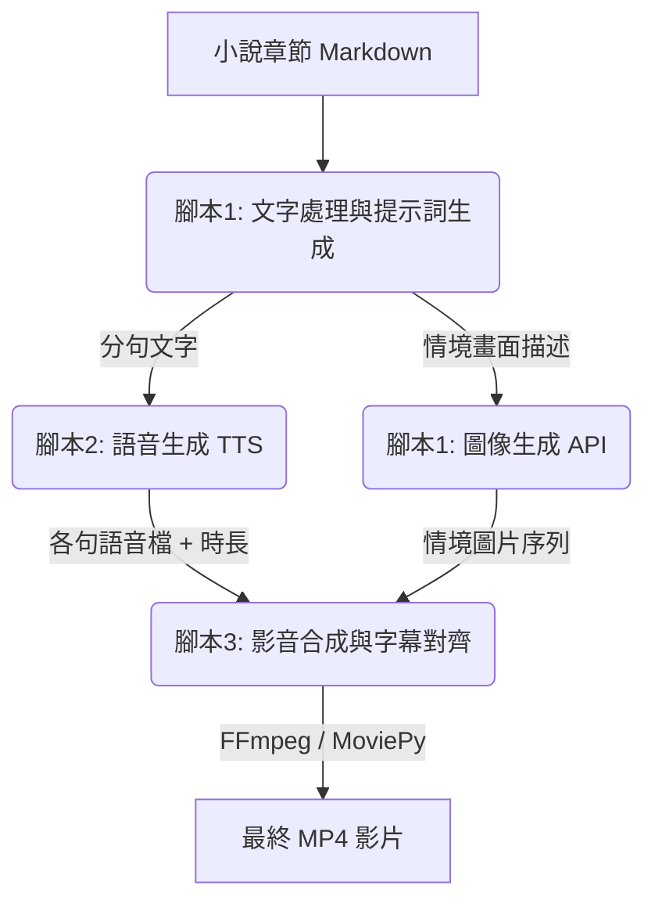

# 小說章節自動轉影片方案：可行性評估與系統設計

這是一個非常前瞻且實用的想法！將長篇小說（3000-5000字/章）自動化轉成配有語音、滾動字幕與情境圖片的影片（類似有聲書投影片或無人版卡拉OK），在技術上是**完全可行且效率極高**的。

以下為您進行詳細的可行性評估，並設計出一套完整的自動化工作流與腳本架構。

---

## 🛠️ 技術可行性與架構設計

我們可以使用 **Python** 作為核心，結合開源的語音、圖像與影音合成工具，建立以下三階段自動化管道（Pipeline）：



### 第一步：畫面文句抽取與圖像生成（Feasibility: 高）
*   **做法**：使用 Python 腳本呼叫大語言模型（如 Gemini API），輸入整章小說，請其分析並輸出 JSON 格式的「視覺場景列表」。
*   **圖像產生**：取得場景描述後，可透過圖像生成 API（如 Stable Diffusion 或 Imagen 3）自動生成對應的系列圖檔，儲存為 `scene_01.png`、`scene_02.png` 等序列。

### 第二步：文字分句與語音生成 TTS（Feasibility: 極高）
*   **做法**：
    1.  用 Python 的正則表達式，以句號（`。`）、問號（`？`）、驚嘆號（`！`）將文章拆分成乾淨的句子陣列。
    2.  呼叫微軟開源且免費的 `edge-tts`（Microsoft Edge 語音引擎），其產生的中文語音非常自然（如 `zh-TW-HsiaoChenNeural` 女聲或 `zh-TW-YunJheNeural` 男聲），且完全不需要 API Key。
    3.  為每一句生成對應的 `.mp3` 檔，並利用 Python 讀取每個音檔的精確時間長度（Duration）。

### 第三步：影音合成與滾動字幕（Feasibility: 高）
*   **做法**：
    1.  **時間軸對齊**：因為每個句子的音檔長度已知，我們可以直接在 Python 中計算出每句的 `開始時間` 與 `結束時間`，自動生成標準的 **SRT / ASS 字幕檔**。
    2.  **畫面切換**：依據句子數量與音檔時長，計算出每張情境圖片應該停留在畫面上的秒數。
    3.  **影音渲染**：使用 `FFmpeg`（執行效率最高）將音檔合併、圖片轉為視訊軌，並將字幕「燒錄（Burn-in）」進影片中。

---

## 💻 核心腳本原型設計

為了讓您能快速理解並實作，以下為您規劃這三個步驟的 Python 實作邏輯：

### 1. 斷句與語音生成（Step 2）
我們使用 `edge-tts` 庫來處理，它能自動下載高音質的語音並回傳時長。

```python
# 依賴安裝：pip install edge-tts mutagen
import asyncio
import edge_tts
import re
from mutagen.mp3 import MP3

async def generate_speech_for_chapter(text_content):
    # 1. 簡單依標點符號分句
    sentences = re.split(r'(?<=[。？！])\s*', text_content.strip())
    sentences = [s for s in sentences if s]
    
    timeline = []
    current_time = 0.0
    
    for i, sentence in enumerate(sentences):
        audio_path = f"audio_{i:03d}.mp3"
        
        # 2. 呼叫 edge-tts 生成語音 (採用台灣微軟女聲)
        communicate = edge_tts.Communicate(sentence, "zh-TW-HsiaoChenNeural")
        await communicate.save(audio_path)
        
        # 3. 獲取音檔精確時長
        audio = MP3(audio_path)
        duration = audio.info.length
        
        timeline.append({
            "index": i,
            "text": sentence,
            "audio": audio_path,
            "start": current_time,
            "end": current_time + duration,
            "duration": duration
        })
        current_time += duration
        
    return timeline
```

### 2. 生成字幕與時間軸對齊（Step 3 核心）
利用上一步得到的時長資料，自動產生 SRT 字幕檔。

```python
def generate_srt_file(timeline, srt_path="subtitles.srt"):
    def format_time(seconds):
        h = int(seconds // 3600)
        m = int((seconds % 3600) // 60)
        s = int(seconds % 60)
        ms = int((seconds - int(seconds)) * 1000)
        return f"{h:02d}:{m:02d}:{s:02d},{ms:03d}"

    with open(srt_path, "w", encoding="utf-8") as f:
        for item in timeline:
            f.write(f"{item['index'] + 1}\n")
            f.write(f"{format_time(item['start'])} --> {format_time(item['end'])}\n")
            f.write(f"{item['text']}\n\n")
```

### 3. FFmpeg 一鍵合成影片（Step 3 合成）
直接呼叫系統的 `FFmpeg`，把「多張圖片 + 多個音檔 + 字幕檔」快速壓製成影片，這比用 Python 重型影像庫（如 MoviePy）快上數十倍，且不易漏記憶體。

```python
import subprocess

def assemble_video(timeline, srt_path="subtitles.srt", output_mp4="output.mp4"):
    # 1. 產生音訊拼接清單 (FFmpeg concat)
    with open("audio_list.txt", "w") as f:
        for item in timeline:
            f.write(f"file '{item['audio']}'\n")
            
    # 2. 合併所有音訊檔為一個主音軌
    subprocess.run("ffmpeg -f concat -safe 0 -i audio_list.txt -c copy main_audio.mp3 -y", shell=True)
    
    # 3. 根據時長生成視訊軌
    # 這裡的邏輯是將您的情境圖片序列，依照每張圖對應的音訊總時長，轉化為對應長度的影片片段，最後合併
    # FFmpeg 語法範例：
    # ffmpeg -loop 1 -i scene_01.png -i main_audio.mp3 -vf "subtitles=subtitles.srt" -shortest output.mp4
    
    print("影片壓製完成！")
```

---

## 💡 方案評估與建議

> [!TIP]
> **推薦的展現形式：ASS 滾動字幕**
> 如果希望文字能像卡拉OK一樣「慢慢向上捲動」或是有精緻的文字底框，建議在第三步使用 **ASS 格式字幕**（Advanced SubStation Alpha）代替傳統的 SRT。ASS 支援字幕定位、滾動特效、卡拉OK逐字變色等，FFmpeg 可以完美支援直接燒錄 ASS 字幕。

### 🌟 優勢
1.  **全自動化**：只要寫好一次這三個 script，以後您每寫完一章，只需一鍵執行，10 分鐘內就能生出一個 20 分鐘的有聲書影片。
2.  **低成本**：使用 `edge-tts` 與 `FFmpeg` 是完全免費且無上限的。
3.  **格式精美**：搭配客製化的字幕樣式與生成式 AI 圖片，成品完成度會非常高。

您覺得這個技術架構符合您的預期嗎？如果您決定要朝這個方向製作，我可以為您撰寫**整套可以直接在您的 Linux 環境下執行**的 Python 工具組！
